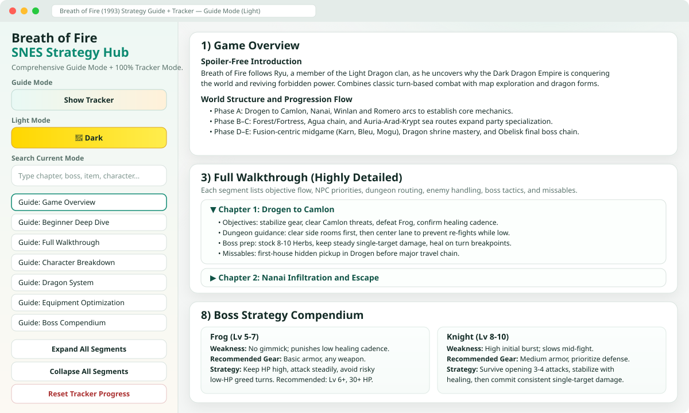
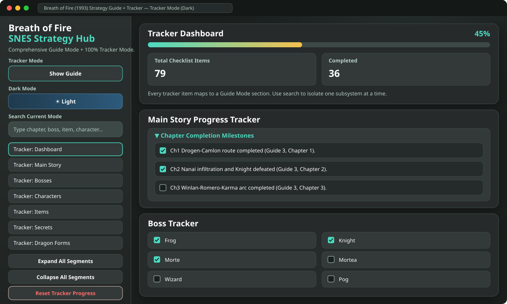
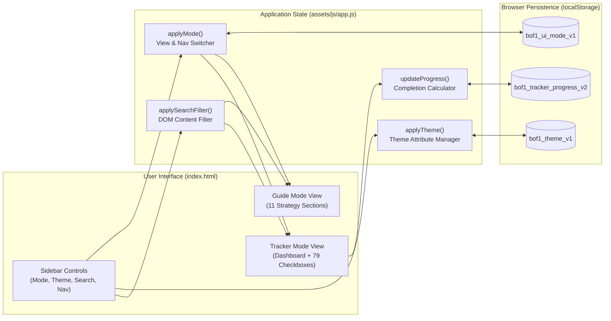

# Breath of Fire (1993) Strategy Guide & 100% Tracker

[](https://github.com/wiwiwinter/breath-of-fire-tracker)
[](https://github.com/wiwiwinter/breath-of-fire-tracker)
[](https://github.com/wiwiwinter/breath-of-fire-tracker)
[](https://github.com/wiwiwinter/breath-of-fire-tracker)

A standalone, zero-dependency web application combining a comprehensive strategy handbook with an interactive 100% completion checklist for **Breath of Fire (1993)**. Built with semantic HTML5, responsive CSS Grid, and vanilla JavaScript, all progress and user preferences persist automatically in your browser's `localStorage`.

> **New to the project?** Read the **[Beginner & Developer Guide (`GUIDE.md`)](GUIDE.md)** for full setup instructions, architectural explanations, customization tips, and code walkthroughs.

---

## Visual Previews

### Guide Mode (Light Theme)
Provides a structured, spoiler-aware strategy handbook covering all 10 story chapters, boss tactics, EXP grinding zones, character breakdowns, and equipment optimization.



### Tracker Mode (Dark Theme)
Tracks 79 completion milestones across 6 categories with real-time completion percentages, progress bar updates, and instant search filtering.



---

## Key Features

- **Dual-Mode Interface (`Guide` & `Tracker`)**
  - **Guide Mode**: Read-only reference handbook organized into 11 comprehensive sections (Overview, Beginner Survival, 10-Chapter Walkthrough, Character Roles, Dragon Shrine Roadmap, Gear Priorities, EXP Grinding Loops, Boss Compendium, Secrets, Endgame Prep, and 100% Route).
  - **Tracker Mode**: Interactive checklist with real-time progress bar and completion counter across Story Milestones, Bosses, Characters, Rare Items, Secrets, and Dragon Forms.
- **Real-Time Context-Aware Search**
  - Filter walkthrough chapters, boss cards, or checklist items instantaneously by town, boss, item, or character name.
  - Automatically hides irrelevant panels while keeping the Tracker Dashboard visible.
- **Automatic Local Persistence**
  - Saves checked tasks (`bof1_tracker_progress_v2`), active view mode (`bof1_ui_mode_v1`), and theme preference (`bof1_theme_v1`) in `localStorage`.
- **Light & Dark Theme Engine**
  - Switch seamlessly between high-contrast Light and Dark color palettes powered by CSS custom properties (`data-theme`).
- **Batch Segment Controls & Responsive Layout**
  - Expand or collapse all `<details>` walkthrough and checklist segments with a single click (respecting active search filters).
  - Adapts from a sticky-sidebar desktop layout to a single-column mobile interface at `1024px` and `900px` breakpoints.

---

## Architecture & Workflow



---

## Content & Checklist Breakdown

| Mode | Section / Category | ID Anchor | Items / Coverage |
| :--- | :--- | :--- | :--- |
| **Guide** | 1) Game Overview | `#guide-overview` | Narrative breakdown, Phases A–E, core mechanics |
| **Guide** | 2) Beginner Deep Dive | `#guide-beginner` | First 2–3 hours survival plan, Zenny economy |
| **Guide** | 3) Full Walkthrough | `#guide-walkthrough` | Chapters 1–10 collapsible routing & missables |
| **Guide** | 4) Character Breakdown | `#guide-characters` | Ryu, Nina, Bo, Karn, Gobi, Ox, Bleu, Mogu + party templates |
| **Guide** | 5) Dragon System | `#guide-dragons` | Shrines 1–3, Agni unlock, AP conservation |
| **Guide** | 6) Equipment Optimization | `#guide-equipment` | Stage priorities, Rod5 fishing, Flea Market phases |
| **Guide** | 7) EXP Leveling Zones | `#guide-exp-zones` | Lv 5–45 grinding loops + solo/duo power windows |
| **Guide** | 8) Boss Strategy Compendium | `#guide-bosses` | Party loadouts + 11 individual boss strategy cards |
| **Guide** | 9–11) Secrets, Endgame & 100% | `#guide-secrets` | Dig spots, sealed chambers, Obelisk prep, 100% route |
| **Tracker** | Main Story Milestones | `#tracker-story` | `10` chapter completion checkboxes (`story-1` to `story-10`) |
| **Tracker** | Boss Tracker | `#tracker-bosses` | `27` boss defeat checkboxes (`boss-1` to `boss-27`) |
| **Tracker** | Character Unlock Tracker | `#tracker-characters` | `8` party recruitment checkboxes (`char-1` to `char-8`) |
| **Tracker** | Item & Equipment Tracker | `#tracker-items` | `16` rare weapon/armor checkboxes (`item-1` to `item-16`) |
| **Tracker** | Secrets & Missables Tracker | `#tracker-secrets` | `8` optional & timed event checkboxes (`sec-1` to `sec-8`) |
| **Tracker** | Dragon Forms Tracker | `#tracker-dragons` | `10` dragon transformation checkboxes (`drag-1` to `drag-10`) |
| **Total** | **All Checklist Categories** | `#tracker-dashboard` | **79 Interactive Checkboxes** |

---

## Repository Structure

```text
breath-of-fire-tracker/
├── index.html                           # Main application markup (Guide & Tracker views)
├── GUIDE.md                             # Detailed beginner & developer documentation
├── README.md                            # Project overview, visuals, and quickstart
└── assets/
    ├── css/
    │   └── styles.css                   # Responsive layout, Light/Dark themes, component styles
    ├── js/
    │   └── app.js                       # State persistence, progress math, search, UI toggles
    └── images/
        ├── guide-mode-preview.svg       # Guide Mode (Light Theme) visual preview
        └── tracker-mode-preview.svg     # Tracker Mode (Dark Theme) visual preview
```

---

## Quick Start

Because the tracker uses vanilla web standards with zero external build steps, you can run it immediately on any operating system:

### Option 1: Direct Browser Launch
1. Clone the repository:
   ```bash
   git clone https://github.com/wiwiwinter/breath-of-fire-tracker.git
   cd breath-of-fire-tracker
   ```
2. Open `index.html` directly in any modern browser:
   - **Windows (PowerShell)**: `start .\index.html`
   - **macOS**: `open index.html`
   - **Linux**: `xdg-open index.html`

### Option 2: Local Development Server (Optional)
If you prefer running over `http://localhost`:
```bash
# Using Node.js
npx serve .

# Or using Python 3
python -m http.server 8000
```

---

## Documentation & Maintenance

For a complete breakdown of how `localStorage` keys work, how to add new checklist items or guide chapters, and how to customize themes, check out **[GUIDE.md](GUIDE.md)**.
